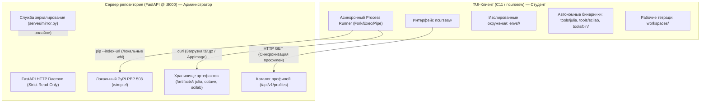

# SysOpenMath Server (TUIOpenMath)

[](https://en.wikipedia.org/wiki/C11_(C_standard_revision))
[](https://invisible-island.net/ncurses/)
[](https://fastapi.tiangolo.com/)
[]()
[]()

> **Автономная клиент-серверная платформа и локальный репозиторий для математических и инженерных вычислений в изолированных сетях (Air-Gapped).**

---

## Оглавление
- [1. Обзор платформы](#1-обзор-платформы)
- [2. Архитектура системы](#2-архитектура-системы)
- [3. Профильная модель вычислений](#3-профильная-модель-вычислений)
- [4. Разграничение доступа (Студент vs Сервер)](#4-разграничение-доступа-студент-vs-сервер)
- [5. Системные требования и зависимости для «чистой» ОС](#5-системные-требования-и-зависимости-для-чистой-ос)
- [6. Быстрый старт](#6-быстрый-старт)
- [7. Управление в интерфейсе (Клавиши навигации)](#7-управление-в-интерфейсе-клавиши-навигации)
- [8. Полный справочник команд make](#8-полный-справочник-команд-make-для-чего-каждая-команда)
- [9. Структура проекта](#9-структура-проекта)

---

## 1. Обзор платформы

**SysOpenMath (TUIOpenMath)** решает ключевую проблему использования научных сред (Jupyter, Python, Julia, GNU Octave, Scilab) в условиях ограниченного или полностью отсутствующего интернета: в учебных компьютерных классах, на олимпиадах, режимных предприятиях и закрытых контурах.

Вместо ручной сборки окружений и зависимости от внешних CDN (PyPI, AWS S3, Debian repos):
1. **Локальный репозиторий-сервер (FastAPI):** Кэширует в локальной сети все Python `.whl` пакеты (собственный PEP 503 индекс), автономные дистрибутивы Julia, переносимые сборки Scilab/Octave и JSON-конфигурации профилей.
2. **Терминальный клиент (C11 / ncursesw):** Предоставляет высокопроизводительный текстовый графический интерфейс для развёртывания стека в один клик, регистрации Jupyter-ядер и запуска рабочих тетрадей.

---

## 2. Архитектура системы



---

## 3. Профильная модель вычислений

Платформа оперирует не отдельными пакетами, а целостными математическими профилями:

| Профиль | Назначение | Состав стека |
| :--- | :--- | :--- |
| **`remote-base`** | Базовая среда | JupyterLab, numpy, pandas, matplotlib, IPython |
| **`remote-scientific`** | Научный комплекс | Scipy, Sympy, Julia LTS + IJulia, Octave, Scilab |
| **`remote-symbolic`** | Аналитические вычисления | Sympy, mpmath, Julia Symbolics, Jupyter |
| **`remote-numerical`** | Численные методы | Scipy, Numba, GNU Octave + octave_kernel |
| **`remote-ml`** | Машинное обучение | Scikit-learn, Seaborn, statsmodels, Torch-ready |
| **`remote-stats`** | Прикладная статистика | Statsmodels, scipy.stats, seaborn, pingouin |
| **`remote-diffeq`** | Дифференциальные уравнения | Scipy (integrate), Julia DifferentialEquations |

Каждый профиль изолирован в собственном каталоге `envs/<имя_профиля>/` с отдельным набором ядер Jupyter.

---

## 4. Разграничение доступа (Студент vs Сервер)

Для предотвращения случайной или умышленной порчи серверного хранилища реализована 3-уровневая изоляция:

1. **Strict Read-Only REST API:** В `server/app.py` реализованы **только HTTP GET** эндпоинты. Сервер не имеет методов `POST`, `PUT`, `DELETE`. Попытка удалённо удалить или заменить файл вернёт `405 Method Not Allowed`.
2. **Отдельный репозиторий студента:** Команда `make client-dist` формирует автономный клиентский дистрибутив `dist/sysopenmath-client/`. В нём **полностью удалены** папка `server/`, скрипты зеркалирования `mirror.py` и хранилище `storage/`.
3. **Разграничение прав ОС:** Сервер запускается под системной службой администратора с правами `chmod 755`, а клиенты работают под непривилегированными пользователями.

---

## 5. Системные требования и зависимости для «чистой» ОС

Монолит **SysOpenMath** полностью автономен: все Python-библиотеки (`.whl`), дистрибутивы Julia, Scilab, Octave и ядра Jupyter упакованы внутри монолита и не скачиваются из интернета.

Для запуска на полностью **«чистом» свежеустановленном компьютере** (Ubuntu / Debian / Astra Linux) требуются только базовые системные пакеты:

### Необходимые пакеты ОС
1. **Инструменты сборки C11:** `gcc`, `make` (или метапакет `build-essential`).
2. **Библиотеки интерфейса:** `libncursesw5-dev` (терминальная графика UTF-8) и `libcjson-dev` (парсер JSON).
3. **Базовый Python:** `python3`, `python3-venv` (для создания изолированных окружений профилей), `python3-pip`.
4. **Системные утилиты:** `curl` (загрузка артефактов с локального сервера), `tar`, `gzip` (распаковка).
5. **Веб-браузер:** любой доступный браузер (Firefox, Chromium и др.) для работы в JupyterLab.

### Установка зависимостей на целевом компьютере (Ubuntu / Debian):
```bash
sudo apt update
sudo apt install -y build-essential gcc make libncursesw5-dev libcjson-dev python3 python3-venv python3-pip curl tar gzip
```

> [!TIP]
> **Если целевой компьютер ВООБЩЕ не имеет доступа в интернет (Air-Gapped с момента установки):**
> * **Вариант А (Готовый бинарник):** Скомпилируйте `manager` на аналогичной ОС (`make`). Тогда в целевой системе не нужны `gcc`, `make` и `*-dev` пакеты — достаточно базового `python3`, `curl` и стандартных runtime-библиотек `libncursesw5`, `libcjson1`.
> * **Вариант Б (Пакеты на флешке):** На компьютере с интернетом скачайте deb-пакеты: `apt-get download build-essential gcc make libncursesw5-dev libcjson-dev python3-venv curl`, перенесите их и установите на чистой машине: `sudo dpkg -i *.deb`.

---

## 6. Быстрый старт

### 1. Запуск локального сервера репозитория
```bash
# Запуск демона FastAPI на http://127.0.0.1:8000
make server
```
*Для остановки сервера:*
```bash
make server-stop
```

### 2. Сборка и запуск TUI-клиента
```bash
make
./manager
# или сразу:
make run
```

---

## 7. Управление в интерфейсе (Клавиши навигации)

Интерфейс TUI состоит из трёх функциональных зон:
1. **Профили** (слева) — список доступных вычислительных сред.
2. **Действия** (справа вверху) — двухуровневое интерактивное меню операций.
3. **Журнал (Лог)** (справа внизу) — вывод консольного вывода и хода выполнения задач в реальном времени.

### Клавиши управления:

| Клавиша | Назначение |
| :---: | :--- |
| **`Tab`** | Циклическое переключение активной секции (**Профили** → **Действия** → **Лог**) |
| **`↑ / ↓`** | Перемещение курсора по профилям, категориям действий или скролл журнала |
| **`Enter`** или **`→`** | Вход в категорию действий или **запуск выбранного действия** |
| **`←`** или **`Backspace`** | Возврат назад из подменю действий в список категорий |
| **`PgUp / PgDn`** | Быстрая прокрутка журнала логов (по 10 строк) |
| **`Home / End`** | Переход в самое начало / конец списка или журнала |
| **`q`** или **`Q`** | Вызов окна подтверждения выхода из программы |
| **`y` / `n`** | Ответ в диалогах подтверждения («Да» / «Нет») |

### Меню «Действия» содержит:
* **[Быстрый старт]** → *Полная установка выбранного профиля* (развёртывание venv, пакетов и ядер в один шаг)
* **[Jupyter]** → *Запуск JupyterLab*, *Остановка JupyterLab*, *Перезапуск*, *Список ядер*
* **[Репозиторий]** → *Синхронизировать профили с сервера*, *Проверка связи (Ping)*, *Переключить офлайн-режим*
* **[Профили]** → *Установка пакетов*, *Обновление*, *Удаление окружения профиля*
* **[Kernels]** → *Регистрация ядер (Python, Julia, Bash, Octave, Scilab)*, *Очистка ядер*
* **[Julia]** → *Установка Julia LTS / Stable*, *Проверка версии*
* **[Системные зависимости]** → *Установка/удаление переносимых Scilab и GNU Octave*
* **[Диагностика]** → *Комплексная проверка готовности (Readiness Check)*, *Состояние компонентов*
* **[Выход]** → *Завершение работы платформы*

---

## 8. Полный справочник команд `make` (Для чего каждая команда)

В проекте все действия автоматизированы через утилиту `make`. Вам не нужно вручную вводить длинные команды компилятора или `python`. 

### 🚀 1. Основные команды (Каждодневная работа)

| Команда | Что делает простыми словами | Когда использовать |
| :--- | :--- | :--- |
| **`make run`** | **Собирает и сразу запускает** графический терминал TUI (`./manager`). | Когда хотите начать работать в интерфейсе. |
| **`make server`** | **Запускает локальный сервер** репозитория на порту 8000 в фоновом режиме. | Перед запуском клиента, чтобы работала локальная загрузка пакетов. |
| **`make server-stop`** | **Останавливает сервер** и освобождает порт 8000. | Когда закончили работу или если сервер завис. |
| **`make`** (или `make all`) | Только компилирует бинарник `manager` из исходников на Си, но не запускает его. | Для проверки компиляции на ошибки. |

---

### 🧹 2. Очистка и сброс (Если нужно начать с нуля)

| Команда | Что делает простыми словами | Когда использовать |
| :--- | :--- | :--- |
| **`make reset`** | **Полный сброс до «заводского состояния»**: удаляет все установленные виртуальные окружения (`envs/`), скачанные среды (`tools/`), ядра, кэш и логи. | Когда хотите провести чистый тест «с чистого листа». Скачанные на сервере архивы (`storage/`) при этом НЕ удаляются! |
| **`make clean`** | Удаляет только скомпилированный бинарный файл `manager`. | Перед полной перекомпиляцией. |

---

### 📦 3. Упаковка для переноса (Флешка / Студенты)

| Команда | Что делает простыми словами | Когда использовать |
| :--- | :--- | :--- |
| **`make bundle`** | **Собирает полный монолитный архив** (`sysopenmath-monolith-offline.tar.gz`). Включает все исходники `.c/.h`, скрипты сервера и все скачанные пакеты. | **Чтобы записать на флешку и пойти сдавать проект на чужом компьютере без интернета.** |
| **`make client-dist`** | **Собирает дистрибутив для студента** (`dist/sysopenmath-client/` и архив `.tar.gz`). | Когда нужно раздать студентам только клиент (без серверной части). |

---

### 🌐 4. Подготовка офлайн-склада (Зеркалирование из интернета)
*Эти команды запускаются один раз на компьютере с интернетом, чтобы наполнить локальное хранилище сервера перед уходом в офлайн:*

| Команда | Что делает простыми словами |
| :--- | :--- |
| **`make mirror-all`** | **Скачать ВООБЩЕ ВСЁ**: Julia, Scilab, Octave, Jupyter и библиотеки для всех 7 профилей разом. |
| **`make mirror-list`** | Показывает отчёт: сколько профилей и файлов сейчас реально лежит в вашем локальном хранилище `server/storage/`. |
| **`make mirror-runtime`** | Скачивает колеса (`.whl`) для JupyterLab, Python-ядра и самого сервера (`fastapi`, `uvicorn`). |
| **`make mirror-julia`** | Скачивает только официальный переносимый архив Julia LTS и проверяет его SHA-256. |
| **`make mirror-scilab`** | Скачивает только переносимый дистрибутив Scilab со встроенной Java JRE. |
| **`make mirror-octave`** | Скачивает только переносимый архив GNU Octave. |

---

### 💡 Простой алгоритм: «Я только что скачал проект, что жать?»

1. **Терминал 1 (поднять сервер):**
   ```bash
   make server
   ```
2. **Терминал 2 (запустить клиент):**
   ```bash
   make run
   ```
3. **Если нужно скинуть другу или преподу на флешку:**
   ```bash
   make bundle
   ```
   *(и забрать файл `sysopenmath-monolith-offline.tar.gz`)*.

---

## 9. Структура проекта

```text
.
├── Makefile                     # Сборка клиента, управление сервером и зеркалами
├── manager.c                    # Точка входа C11 TUI
├── config/
│   └── client.json              # Сетевой адрес сервера и таймауты
├── include/                     # Заголовочные файлы подсистем клиента
├── src/                         # Реализация логики клиента (ncurses, managers)
│   ├── actions.c                # Диспетчер действий горячих клавиш
│   ├── install_steps.c          # Загрузка и развёртывание артефактов
│   ├── setup_manager.c          # Атомарный генератор сценариев Full Setup
│   ├── julia_manager.c          # Интеграция и верификация Julia LTS
│   ├── octave_manager.c         # Интеграция GNU Octave
│   ├── scilab_manager.c         # Интеграция Scilab
│   ├── jupyter_manager.c        # Управление изолированным JupyterLab
│   └── ui.c                     # Отрисовка TUI (адаптивный ncursesw)
├── server/                      # Локальный сервер репозиториев
│   ├── app.py                   # FastAPI REST API (Strict Read-Only)
│   ├── mirror.py                # Утилита зеркалирования PyPI, Julia, Scilab
│   ├── start.sh                 # Скрипт надёжного запуска uvicorn
│   └── storage/                 # Локальное хранилище пакетов и профилей
│       ├── artifacts/           # Бинарные архивы (.tar.gz, AppImage)
│       ├── packages/            # Python .whl пакеты (PEP 503)
│       └── profiles/            # JSON-декларации профилей
└── dist/
    └── sysopenmath-client/      # Выделенный изолированный репозиторий студента
```

---

## Лицензия
Проект распространяется под открытой лицензией MIT. Подходит для использования в учебных заведениях, университетах и научно-исследовательских институтах.
