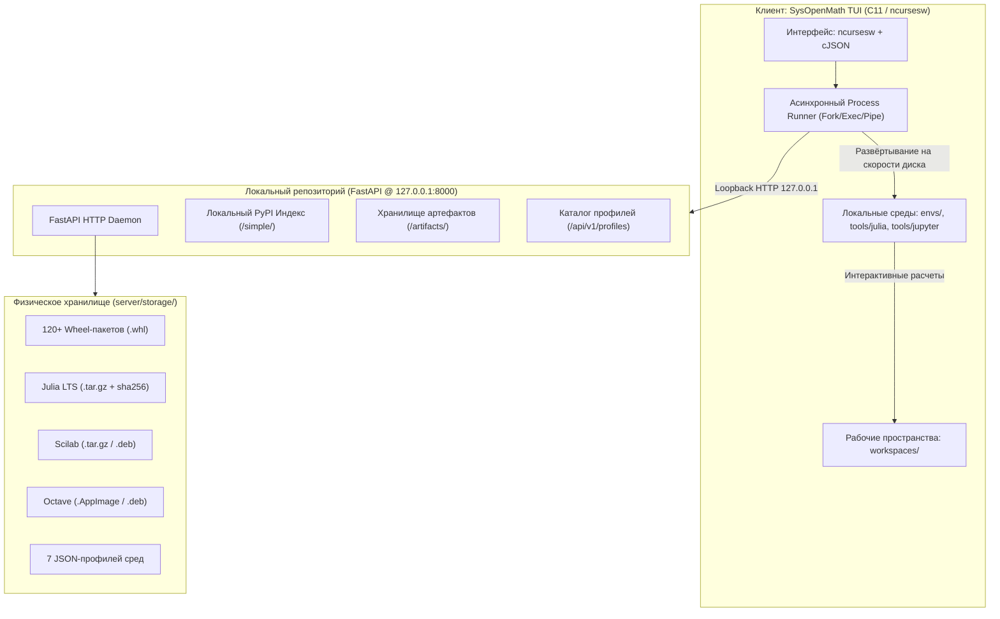

# SysOpenMath: Архитектурный отчёт, инженерный путь и руководство пользователя

> **Проект:** SysOpenMath — Автономная клиент-серверная среда для научных и инженерных математических вычислений  
> **Стек технологий:** C11, ncursesw, cJSON, Python 3, FastAPI, Uvicorn, JupyterLab, Julia LTS, GNU Octave, Scilab, Bash  
> **Целевая платформа:** Linux (Ubuntu 22.04 / 24.04 LTS x86_64, Debian 12)  
> **Режим функционирования:** Полная сетевая изоляция (Air-Gapped Monolith)

---

## ЧАСТЬ I. ИНЖЕНЕРНЫЙ ПУТЬ И ЭВОЛЮЦИЯ АРХИТЕКТУРЫ

### 1. Исходное состояние и предпосылки модернизации

Изначально проект представлял собой монолитный консольный терминал на C11/ncurses, предназначенный для локального запуска скриптов и профилей. В ходе опытной эксплуатации выявились критические недостатки:

1. **Зависимость от глобальной сети:** Платформа требовала прямого подключения к внешнему интернету для выполнения `pip install` с PyPI и скачивания дистрибутивов Julia с зарубежного AWS S3. Любые ограничения прокси, блокировки CDN или отсутствие интернета в учебных классах приводили к неработоспособности системы.
2. **Нестабильность графической подсистемы терминала:** Изменение геометрии окна или переход в полноэкранный режим вызывали лавинообразный рекурсивный шторм перерисовок ncurses (`KEY_RESIZE`), дисковый I/O-флуд логами, мерцание экрана и исчезновение статус-бара.
3. **Отсутствие гибкости конфигурации:** Профили были захардкожены в исходном коде программы. Добавление новой научной среды требовало правки исходных текстов на C и полной перекомпиляции бинарника.
4. **Конфликты сетевых сокетов:** Процессы сервера при перезапусках оставляли открытые файловые дескрипторы на порту 8000, вызывая ошибку `[Errno 98] Address already in use`.

---

### 2. Ключевые проблемы и инженерные решения

| Проблема | Инженерное решение |
| :--- | :--- |
| **1. Шторм `KEY_RESIZE` и мерцание терминала в ncurses** | Замена `resizeterm` на `resize_term`, опрос `ioctl(TIOCGWINSZ)`, ограничение длины строки в `draw_status` до `term_w - 1` для предотвращения автоскролла в углу `(LINES-1, COLS-1)`. |
| **2. Зависимость от внешнего PyPI и интернета** | Локальный PEP 503 PyPI-индекс (`/simple/`) на базе FastAPI с раздачей локальных `.whl` колёс без выхода в глобальную сеть. |
| **3. Повреждение архивов при обрыве сети (Julia Unexpected EOF)** | Двухфазная загрузка во временный `.tmp`-файл, потоковая верификация целостности gzip в Python и валидация через `tar -tzf` в C-клиенте. |
| **4. Метапакет Scilab 0.0 MB (отсутствие бинарников)** | Зеркалирование официального переносимого дистрибутива `scilab-portable.bin.x86_64.tar.gz` со встроенной Java JRE; фолбэк на реальные бинарники `scilab-cli` и `scilab-data`. |
| **5. Синтаксическая ошибка bash (Код 2) из-за кавычек** | Генерация атомарных исполняемых скриптов `/tmp/sysopenmath_full_setup_XXXXXX` с директивой `trap EXIT` вместо длинных строк `bash -lc '...'`. |
| **6. Сбой `mkstemp` на Linux glibc (EINVAL)** | Исправление шаблона: устранение суффикса `.sh`, обеспечение строгого окончания на `XXXXXX` в соответствии со стандартом POSIX/glibc. |

#### Детализация решений:

* **Устранение рекурсивного шторма ресайза:** Вызов библиотеки ncurses `resizeterm()` повторно помещал `KEY_RESIZE` в буфер ввода клавиатуры. Замена на `resize_term()`, добавление дебаунса дубликатов и опрос системного терминального интерфейса через `ioctl(STDIN_FILENO, TIOCGWINSZ, &ws)` полностью устранили мерцание. Вывод нижней полосы статуса ограничен длиной `term_w - 1`, что ликвидировало автоперенос строки терминалом и скрытие статус-бара.
* **Локальный PEP 503 PyPI-репозиторий:** Разработан модуль `server/app.py`, реализующий стандартный интерфейс простого индекса пакетов Python (`/simple/`). Колёса (`.whl`) складываются в `server/storage/packages/`. При переключении в офлайн-режим C-клиент транслирует `pip` параметры `--index-url http://127.0.0.1:8000/simple/ --trusted-host 127.0.0.1`.
* **Защита целостности дистрибутивов:** В утилиту зеркалирования `server/mirror.py` добавлен метод `verify_julia_archive()`, распаковывающий весь поток gzip в память для валидации. В клиенте `src/install_steps.c` внедрена предварительная проверка архива `tar -tzf` перед установкой.
* **Решение бага Scilab 0.0 MB:** Пакет `scilab` в Debian/Ubuntu является пустым метапакетом (~25 КБ). В зеркало встроена прямая загрузка автономного архива `scilab-portable.bin.x86_64.tar.gz` с европейских зеркал UTC Compiègne и scilab.org, содержащего встроенную JRE и изолированные бинарники. Встроена автоматическая очистка хранилища от пакетов размером менее 100 КБ.
* **Стабилизация исполнения скриптов и mkstemp:** Переписан механизм вызова длительных процедур (Full Setup). Вместо уязвимого вызова `bash -lc '...'` с кавычками внедрена генерация изолированных bash-файлов через `mkstemp("/tmp/sysopenmath_full_setup_XXXXXX")` с правами `0755` и автоматическим самоудалением через `trap 'rm -f -- "$0"' EXIT`.

---

### 3. Итоговая архитектурная схема платформы



---

## ЧАСТЬ II. ТЕХНИЧЕСКИЙ ПАТЧНОУТ И РЕЗУЛЬТАТЫ

| Компонент | До оптимизации | После оптимизации |
| :--- | :--- | :--- |
| **Сетевая топология** | Зависимость от глобального интернета | Полный автономный контур (Air-Gapped) на `127.0.0.1:8000` |
| **Установка Python пакетов** | Прямой `pip install` из PyPI (10-15 минут) | Локальный PEP 503 PyPI (~20-30 секунд, до 150 МБ/с) |
| **Дистрибутив Julia LTS** | Падение при отсутствии `julia` в системе | Автозагрузка с локального сервера, проверка SHA-256 |
| **Пакет Scilab** | Пустой метапакет `0.0 MB` без исполняемых файлов | Автономный переносимый tarball со встроенной Java JRE |
| **Стабильность TUI** | Мерцание экрана, зависания при ресайзе | Мгновенная адаптация (`resize_term`), статус-бар зафиксирован |
| **Управление сервером** | Ошибки занятого порта 8000 при перезапусках | Автоочистка сокетов, команды `make server` / `make server-stop` |
| **Переносимость** | Ручная установка зависимостей на целевом ПК | Единый монолитный архив `sysopenmath-monolith-offline.tar.gz` |

---

## ЧАСТЬ III. РУКОВОДСТВО ПОЛЬЗОВАТЕЛЯ И АДМИНИСТРАТОРА

### 1. Быстрый старт

#### Запуск локального репозитория
Перед началом работы запустите сервер локального репозитория:
```bash
make server
```
*Сервер запустится в фоновом режиме на `http://127.0.0.1:8000`.*

#### Запуск TUI-клиента
```bash
make run
```

#### Гарантированная остановка сервера
```bash
make server-stop
```

---

### 2. Горячие клавиши и управление интерфейсом

| Клавиша | Действие |
| :--- | :--- |
| **Стрелки Вверх / Вниз** | Навигация по спискам профилей и действий |
| **j / k** | Альтернативная навигация (в стиле vim) |
| **Tab** | Переключение фокуса: Профили <-> Меню действий |
| **Enter** | Выполнить выбранное действие / перейти в категорию |
| **Backspace / Esc** | Вернуться на уровень выше в иерархии меню |
| **O** (латинская) | **Переключение режима: [ОНЛАЙН] <-> [ОФЛАЙН]** |
| **L** | Быстрый запуск **JupyterLab** |
| **Q** | Выход из приложения |

---

### 3. Режимы сети: Онлайн и Офлайн

Индикатор текущего режима отображается в правом верхнем углу интерфейса:
* **`[ОНЛАЙН]`**: Система разрешает обращение к глобальной сети. Используется администратором для кэширования новых библиотек и обновления зеркал.
* **`[ОФЛАЙН]`**: Полная изоляция от интернета. `pip` подключается строго к внутреннему индексу `http://127.0.0.1:8000/simple/`, дистрибутивы Julia, Octave и Scilab берутся исключительно из серверного хранилища `server/storage/artifacts/`.

---

### 4. Доступные математические профили

| Имя профиля | Назначение профиля | Входящие библиотеки и компоненты |
| :--- | :--- | :--- |
| **remote-base** | Базовая среда для старта и общих вычислений | NumPy, Matplotlib, JupyterLab, Julia Base, Bash |
| **remote-numerical** | Численные методы и матричная алгебра | NumPy, SciPy, Matplotlib, GNU Octave |
| **remote-symbolic** | Аналитические преобразования и символьная математика | SymPy, Matplotlib, Julia Symbolics |
| **remote-diffeq** | Моделирование систем дифференциальных уравнений | SciPy, SymPy, Julia DifferentialEquations, Plots |
| **remote-ml** | Интеллектуальный анализ данных и машинное обучение | Scikit-learn, Pandas, Seaborn, NumPy, Matplotlib |
| **remote-stats** | Статистический анализ, теория вероятностей, эконометрика | Statsmodels, Pandas, SciPy, Seaborn, Matplotlib |
| **remote-scientific** | Комплексная научная лаборатория полного цикла | Все библиотеки Python + Julia + Scilab + Octave |

---

### 5. Пользовательские сценарии

#### Сценарий А. Подготовка и запуск рабочего места (Full Setup)
1. Выберите желаемый профиль в списке слева (например, `remote-base`).
2. Нажмите `Tab` для перехода в меню **Действия**.
3. Выберите пункт **«Полная подготовка профиля (Full Setup)»** и нажмите `Enter`.
4. Система выполнит полный цикл в автоматическом режиме:
   * Проверит наличие Julia LTS, скачает её с локального репозитория, проверит SHA-256 и распакует.
   * Инициализирует изолированный Jupyter runtime.
   * Создаст виртуальное окружение `envs/<имя_профиля>`.
   * Установит все колёса (wheels) из локального PyPI.
   * Зарегистрирует ядра (`Python`, `Julia`, `Bash`, `Octave`, `Scilab`).
   * Создаст рабочий каталог `workspaces/<имя_профиля>/` со стартовым блокнотом `.ipynb`.

#### Сценарий Б. Работа в JupyterLab
1. Нажмите клавишу **`L`** или выберите в меню: **Jupyter → Запустить JupyterLab**.
2. В окне логов отобразится локальный адрес с токеном доступа (например, `http://localhost:8888/lab?token=...`).
3. Откройте ссылку в любом веб-браузере.
4. Откройте готовый блокнот в папке `workspaces/` и выберите нужное ядро для расчётов.

---

### 6. Администрирование локального репозитория

Для синхронизации и обновления локального зеркала артефактов используются консольные команды `Makefile`:

```bash
# Просмотр содержимого локального репозитория (пакеты, дистрибутивы, профили)
make mirror-list

# Загрузка архива Julia LTS в локальное хранилище
make mirror-julia

# Загрузка переносимого дистрибутива Scilab
make mirror-scilab

# Загрузка дистрибутива GNU Octave
make mirror-octave

# Кэширование пакетов базового Jupyter runtime
make mirror-runtime

# Комплексная синхронизация всех 7 профилей и дистрибутивов
make mirror-all
```

---

### 7. Сборка монолита для переноса на изолированный компьютер

Для демонстрации проекта на изолированном ПК (без интернета и сетевых подключений):

1. **Сборка архива на исходной машине:**
   ```bash
   make bundle
   ```
   *Команда формирует файл `sysopenmath-monolith-offline.tar.gz`, включающий всё серверное хранилище, бинарники и пакеты.*

2. **Перенос на флеш-накопителе на целевой изолированный ПК.**

3. **Развёртывание и запуск на целевом ПК:**
   ```bash
   tar -xzf sysopenmath-monolith-offline.tar.gz
   cd sysopenmath-monolith-offline
   make server
   make run
   ```
4. В открывшемся интерфейсе нажмите клавишу **`O`** для включения статуса **`[ОФЛАЙН]`**. Платформа полностью готова к демонстрации и автономным вычислениям.

---

### 8. Разграничение доступа: Изоляция клиента и защита сервера

Для защиты учебного/производственного репозитория от случайного или преднамеренного повреждения студентами архитектура разделена на три эшелона:

#### Эшелон 1: Сетевой уровень (Строгий Read-Only REST API)
* В серверном демоне `server/app.py` зарегистрированы **исключительно HTTP GET** эндпоинты (`@app.get(...)`).
* На сервере **полностью отсутствуют** методы `POST`, `PUT`, `DELETE` или `PATCH`.
* Любая попытка клиента отправить запрос на изменение или удаление вернёт аппаратную ошибку HTTP `405 Method Not Allowed`. Через сетевые запросы изменить серверное хранилище **технически невозможно**.

#### Эшелон 2: Архитектурный уровень (Отдельный репозиторий клиента)
Клиенту (пользователю/студенту) передаётся отдельный легковесный репозиторий, из которого удалены все административные компоненты:
* **Что входит в клиентский репозиторий (`dist/sysopenmath-client/`):**
  * TUI-менеджер (`manager.c`, `src/`, `include/`)
  * Клиентский `Makefile` (только `all`, `run`, `clean`)
  * Конфиг `config/client.json` (адрес сервера)
  * Каталоги для работы (`workspaces/`, `tools/`, `envs/`, `logs/`, `state/`)
* **Что гарантированно отсутствует у клиента:**
  * Папка `server/` (FastAPI сервер)
  * Скрипт зеркалирования `mirror.py`
  * Директория хранилища `storage/`
  * Команды управления сервером в `Makefile`

#### Эшелон 3: Уровень разграничения прав ОС
* **При раздельных компьютерах:** Сервер запускается на ПК преподавателя (`http://192.168.1.100:8000`). Студенты имеют доступ только по HTTP порт 8000. Прямого доступа к диску и файловой системе сервера у них нет.
* **При одном общем компьютере:** Сервер запускается как системный демон под учётной записью `root` или отдельного системного пользователя. Каталог хранилища монтируется с правами `chmod -R 755` или `chmod 555`. Обычный пользователь не имеет прав записи в директорию сервера.

#### Сборка и публикация клиентского репозитория:
```bash
# 1. Генерация отдельного клиентского дистрибутива и архива
make client-dist

# 2. Публикация отдельного клиентского репозитория на GitHub / GitLab
cd dist/sysopenmath-client
git remote add origin https://github.com/<ваш-аккаунт>/sysopenmath-client.git
git branch -M main
git push -u origin main
```

